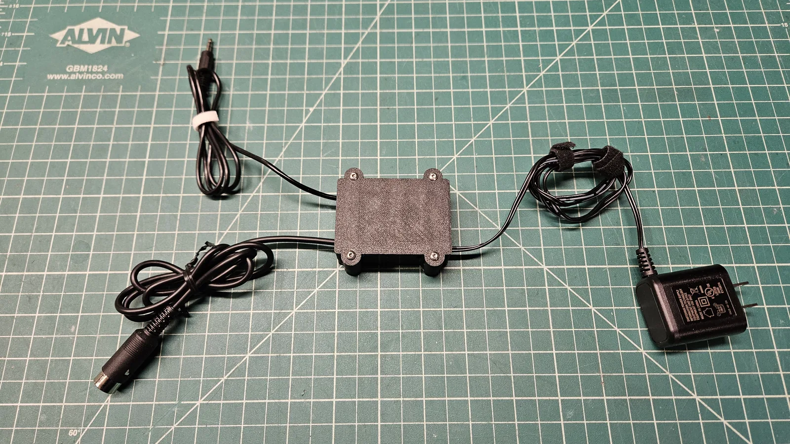
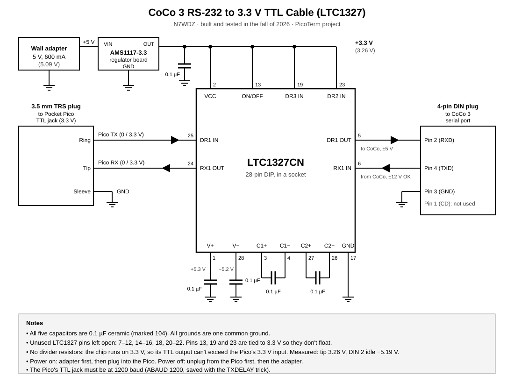
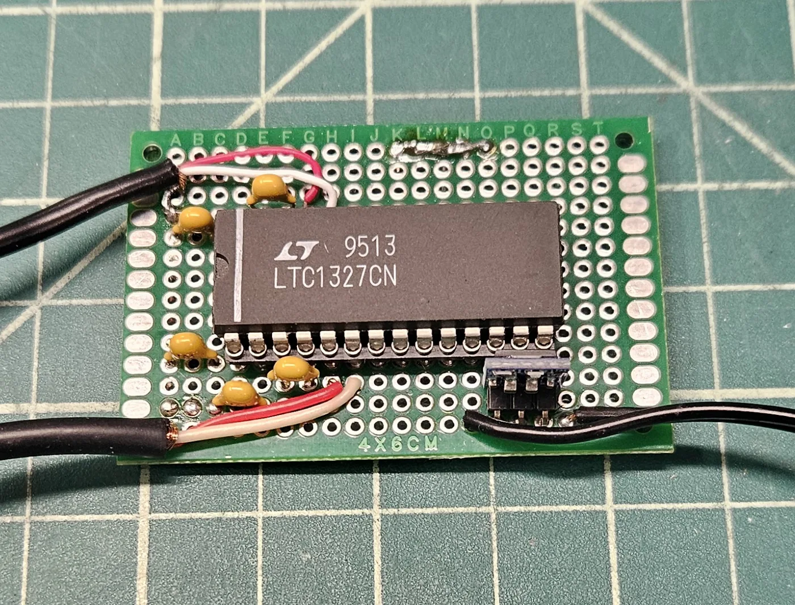
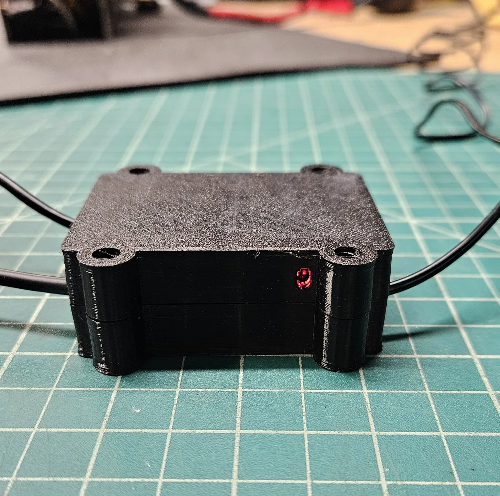

# Cable: Pocket Pico to CoCo 3

The Pocket Pico's serial jack is 3.3 V TTL. The CoCo 3's 4-pin serial port
uses RS-232 levels (about +/-12 V). A level converter chip goes in between.
Never connect the Pico straight to the CoCo.

## Connectors

**Pocket Pico, 3.5 mm TRS jack**

| Contact | Signal |
|---|---|
| Tip | Pico receive (RX) |
| Ring | Pico transmit (TX) |
| Sleeve | ground |

**CoCo 3, 4-pin DIN serial port**

| Pin | Signal |
|---|---|
| 1 | carrier detect (not used) |
| 2 | CoCo receive (RXD in) |
| 3 | ground |
| 4 | CoCo transmit (TXD out) |

There are three ways to build it below. The first is the cable I use; the
other two work too.

## My cable: LTC1327 at 3.3 V (built and in use)



A bare **LTC1327CN** (Linear Technology, now Analog Devices) on a 4 x 6 cm
perfboard. The chip was donated by Peter, KF7PSM. It runs on 3.3 V, so its
TTL output can never go above what the Pico takes, and no divider resistors
are needed. Its outputs are EIA/TIA-562 levels (about +/-5 V), which the
CoCo's RS-232 input reads fine, and its inputs take the CoCo's +/-12 V.



**Parts**

- LTC1327CN, 28-pin DIP, in a 28-pin socket
- Five 0.1 uF ceramic capacitors (marked 104)
- AMS1117-3.3 regulator board
- 5 V wall adapter (mine is 600 mA, measures 5.09 V)
- 4 x 6 cm perfboard, 3.5 mm TRS plug, 4-pin DIN plug, cable

**Connections** (we use driver 1 and receiver 1)

| LTC1327 pin | Name | Connect to |
|---|---|---|
| 1 | V+ | 0.1 uF to ground |
| 2 | VCC | 3.3 V, plus 0.1 uF to ground |
| 3, 4 | C1+, C1- | 0.1 uF between them |
| 5 | DR1 OUT | CoCo DIN 2 (CoCo receive) |
| 6 | RX1 IN | CoCo DIN 4 (CoCo transmit) |
| 13 | ON/OFF | 3.3 V (low = shut down, must not float) |
| 17 | GND | ground: regulator, Pico sleeve, CoCo DIN 3 |
| 19, 23 | DR3 IN, DR2 IN | 3.3 V (unused driver inputs, must not float) |
| 24 | RX1 OUT | Pico tip (Pico receive) |
| 25 | DR1 IN | Pico ring (Pico transmit) |
| 26, 27 | C2-, C2+ | 0.1 uF between them |
| 28 | V- | 0.1 uF to ground |

All other pins (7-12, 14-16, 18, 20-22) are left open. The wall adapter feeds
the AMS1117's input; its 3.3 V output feeds the chip.

**Build it in steps, with a meter check after each.** Socket and capacitors,
then the regulator, then the 3.3 V and ground wiring, then the plugs. Leave
the chip out until the regulator's output reads 3.3 V at the empty socket.

**Readings on mine**, chip in, nothing plugged into the Pico:

| Point | Reading |
|---|---|
| Regulator output / pin 2 | 3.26 V |
| Pin 1 (V+) | +5.3 V |
| Pin 28 (V-) | -5.2 V |
| Tip to sleeve | 3.26 V (never above 3.3 V) |
| DIN 2 to DIN 3, idle | -5.19 V |



**Power order:** wall adapter first, then plug into the Pico. Shutting down:
unplug from the Pico first, then the adapter. The red LED on the regulator
board shows the cable has power.

**Case:** a 3D-printable case for this board is in [../enclosure](../enclosure).



## Option A: 3.3 V converter board (MAX3232 / SP3232), no resistors

A MAX3232 or SP3232 board powered from 3.3 V (for example an AMS1117-3.3
regulator board) has TTL outputs that are safe for the Pico as they are.

```
Pico ring (TX) ──── TTL in  ─[converter]─ RS-232 out ──── DIN 2 (CoCo RXD)
Pico tip  (RX) ──── TTL out ─[converter]─ RS-232 in  ──── DIN 4 (CoCo TXD)
Pico sleeve    ──── GND ──────────────────────────────── DIN 3 (ground)
```

Converter boards label their TTL pins differently (TXD/RXD can mean either
direction), so check the board's chip pins with a meter before wiring.

## Option B: 5 V converter (MAX232 / ICL232) with a divider

A 5 V-only chip puts out up to 5 V on its TTL side, too much for the Pico.
Add a divider on the receive output going to the Pico's tip:

```
R OUT ──[2k]──┬── tip (Pico RX)
              │
            [3.3k]
              │
GND ──────────┴── sleeve (Pico ground)

T IN ──────────── ring (Pico TX)
```

With an ICL232 (receive output high 3.5 V minimum, 4.6 V typical) the tip sees
about 2.9 V typical and never less than about 2.2 V, above the Pico's 2.0 V
"high" threshold, and never more than 3.3 V. 1.8k works too; avoid going much
lower than 1.8k (the tip can go over 3.3 V) or much higher than 2.2k (too
little margin).

This is the cable PicoTerm was first tested with, a test cable donated by
Peter, KF7PSM (12 V supply, 7805 regulator, four 22 uF capacitors): ICL232 channel 1
(T1 IN 11, R1 OUT 12, R1 IN 13, T1 OUT 14, GND 15, VCC 16), T1 OUT to DIN 2,
R1 IN to DIN 4, GND to DIN 3.

## Meter checks before plugging in the Pico

With the cable powered and nothing plugged in:

1. Converter supply: 3.3 V (LTC1327 and option A) or 5 V (option B).
2. Tip to sleeve: about 3.3 V (LTC1327 and option A) or about 2.9 V
   (option B). The receive line idles high.
3. DIN 2 to DIN 3: about -5 V (LTC1327) or -5 to -9 V (options A and B).
   RS-232 idle is negative.
4. Plug the DIN into the CoCo (CoCo off first), turn it on: the tip should
   still read the same as in step 2.

## Loopback test

If PicoTerm gets no answer, unplug the Pico and connect the plug's tip to its
ring with a clip lead (not the sleeve). Type on the CoCo in PicoTerm: the
letters should show on screen. If they do, the cable and the CoCo are fine and
the problem is on the Pico side (usually its speed, see
[pocket-pico-1200-baud.md](pocket-pico-1200-baud.md)).
